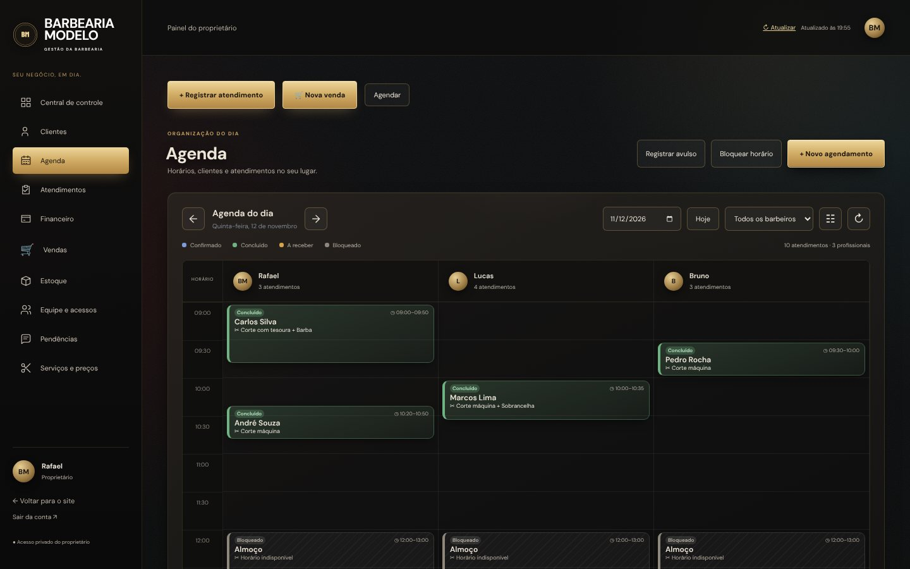
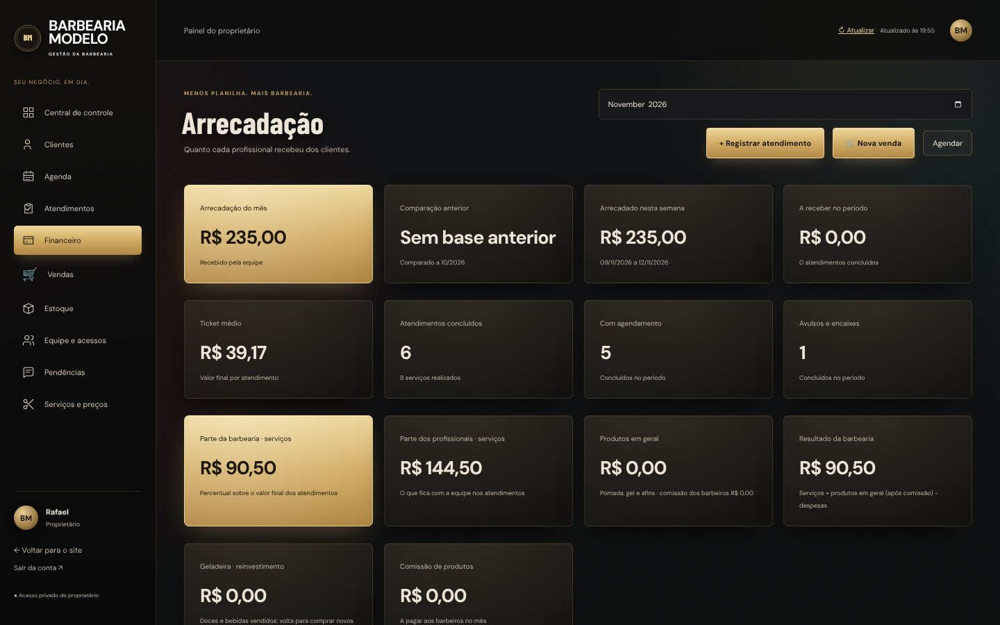
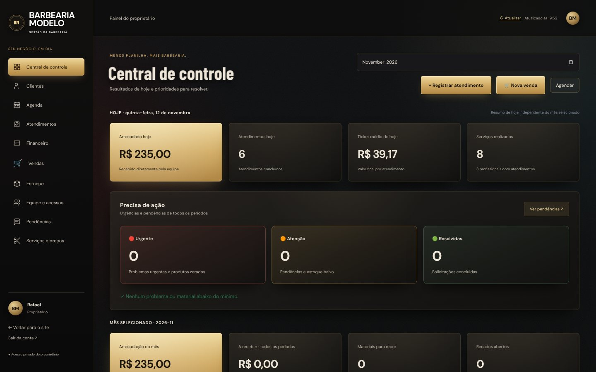
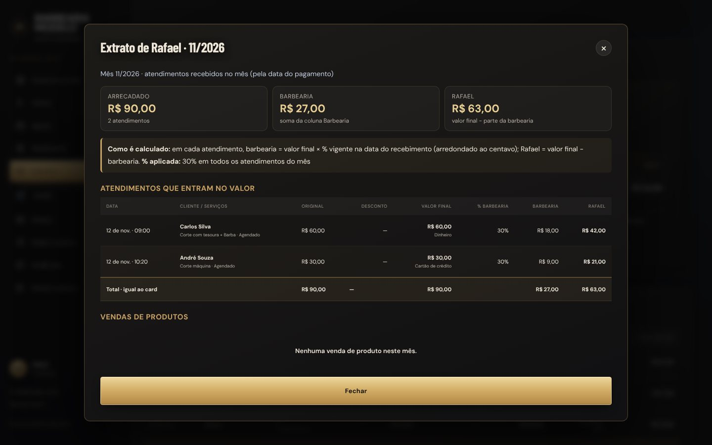

# Sistema de barbearia — site, agenda online e gestão

Site público com agendamento online e um sistema de gestão completo para uma barbearia com três profissionais: agenda da equipe, fechamento de atendimentos, controle de faltas, divisão financeira por profissional e painel do proprietário.

> **Projeto de portfólio.** Feito para um cliente real e publicado aqui com os dados **anonimizados**. A marca "Barbearia Modelo", os profissionais (Rafael, Bruno e Lucas), os telefones, o endereço, o logo, as fotos e as porcentagens são fictícios.

**▶ [Abrir a demonstração](https://infogabrielduarte-star.github.io/sistema-barbearia/demo/)** — na "Área dos barbeiros", usuário `dono` e senha `123`.


## O que o sistema faz

**Para o cliente (sem login)**
- Escolhe serviços (a duração é somada), o profissional, o dia e o horário livre. A confirmação é imediata.
- O site só oferece horários dentro do expediente (terça a sábado, 9h–19h), fora do almoço (12h–13h) e com 20 minutos de antecedência.
- Na confirmação, botões de WhatsApp com a mensagem já preenchida (lembrete e contato com o profissional).

**Para os barbeiros (celular)**
- Agenda própria, encaixes, bloqueios de horário, remarcar e cancelar.
- Fechamento do atendimento com o valor cobrado por serviço, desconto e forma de pagamento (Pix, dinheiro, débito, crédito).
- Registro rápido de atendimento sem agendamento.
- Botão **"Cliente faltou"**: liberado só após 15 minutos de tolerância. Gera uma pendência de 50% do valor, que aparece no próximo agendamento do cliente e é cobrada junto no fechamento.

**Para o proprietário**
- Central de controle, agendas lado a lado, clientes, atendimentos e serviços/preços.
- **Divisão financeira:** cada profissional tem uma % da barbearia com histórico de vigência. A divisão incide sobre o valor final, é calculada em centavos e sempre fecha.
- **Extrato por profissional:** atendimento a atendimento, com a % aplicada em cada um e totais iguais aos do card.
- Logins da equipe: criar, redefinir senha e bloquear (bloquear encerra as sessões abertas na hora).
- Correção de valores com motivo obrigatório, estorno e histórico (auditoria). Registro financeiro nunca é apagado.

| Agenda da equipe | Financeiro |
|---|---|
|  |  |
| **Central de controle** | **Extrato por profissional** |
|  |  |

<p align="center"></p>

## Destaques técnicos

- **Nenhum horário duplicado, em três camadas:** a disponibilidade é calculada no banco; cada gravação passa por uma função SQL com trava por profissional e dia (`pg_advisory_xact_lock`); e uma restrição de exclusão em `tstzrange` (`btree_gist`) recusa qualquer sobreposição, mesmo escrevendo direto por SQL. Testado com 6 clientes disputando o mesmo horário ao mesmo tempo: só 1 consegue.
- **Almoço travado em todos os caminhos:** site, agendamento e encaixe pelo painel, atendimento avulso e remarcação.
- **Permissões no servidor:** o profissional da ação vem sempre da sessão. Um barbeiro não marca, não vê e não altera o que é de outro, mesmo que mande outro nome na requisição.
- **Autenticação própria:** senha com `scrypt`, sessão em cookie `httpOnly`/`SameSite=Lax`/`Secure`, sessões revogáveis em tabela, limite de tentativas, proteção CSRF (só JSON + verificação de `Origin`).
- **Idempotência:** chave por requisição, então um toque duplo não cria dois agendamentos nem fecha duas vezes. Controle de versão evita que duas pessoas sobrescrevam a mesma alteração.
- **Datas e dinheiro corretos:** `timestamptz` com regras em `America/Sao_Paulo`; valores em centavos (inteiros).
- **Supabase seguro:** RLS ligado e a API REST pública sem acesso a nenhuma tabela, view ou função. Só o servidor fala com o banco.
- **Primeiro acesso sem terminal:** o proprietário cria o próprio login numa página protegida por um código da hospedagem, que se desliga sozinha depois de usada.
- **Poucas dependências:** só o driver `pg`.

## Tecnologias

| Camada | Tecnologia |
|---|---|
| Front-end | HTML, CSS e JavaScript puro (ES modules), responsivo e mobile-first. Hero com WebGL2 e SVG |
| Back-end | Node.js 22+ com TypeScript executado direto pelo Node (sem build) e `node:http` (sem framework) |
| Banco | PostgreSQL (Supabase): SQL puro, migrações versionadas, regras críticas em funções PL/pgSQL |
| Testes | `node:test` contra PostgreSQL real (32 testes) e Playwright para os fluxos no navegador |
| Hospedagem | Um único serviço Node (Hostinger) e banco gerenciado (Supabase) |

## Estrutura

```
public/          site e painéis (index.html, app.js, planner.js, operations.js, finance.js…)
src/             servidor: servidor.ts, rotas/ (publico, equipe, painel), auth/, db/, domain/, scripts/
db/              migrations/ (0001 tabelas e anti-sobreposição · 0002 painel, faltas, % por profissional), seed.sql, supabase.sql
tests/           regras puras + API contra banco real
docs/            api.md (contratos), backend.md, modelo-financeiro.md, deploy-hostinger.md
docs/demo/       demonstração estática (GitHub Pages): a mesma interface com a API simulada no navegador
```

## Rodar localmente

Requisitos: Node 22.18 ou mais novo e um PostgreSQL.

```bash
npm install
cp .env.example .env                          # ajuste DATABASE_URL
npm run db:seed                               # migrações + serviços, profissionais e horários (sem dados de teste)
npm run usuario -- --barbeiro "Rafael" --usuario dono --papel owner   # cria o login do proprietário
npm run dev                                   # http://localhost:3000
```

Testes (criam e apagam bancos temporários):

```bash
TEST_DATABASE_URL="host=/var/run/postgresql user=postgres" npm test
npm run typecheck
```

**Só a interface, sem banco:** sirva a pasta `docs/demo` (por exemplo `npx serve docs/demo`). Na "Área dos barbeiros", entre com usuário `dono` e senha `123`. Ali os dados ficam só na memória do navegador.

## Documentação
- [Contratos da API](docs/api.md)
- [Como o back-end funciona](docs/backend.md)
- [Modelo financeiro (divisão e comissões)](docs/modelo-financeiro.md)
- [Publicar na Hostinger + Supabase](docs/deploy-hostinger.md)
